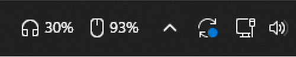

# Wireless Battery (G435 fork)

Battery levels of your wireless mouse, headset, keyboard and controller on Windows — with **Logitech G435** support for both LIGHTSPEED receivers (`046D:0ACB` Realtek and `046D:0ADF` Holtek).

**1.2.0 is the final release for the original Realtek dongle (`046D:0ACB`).** Upstream supports the newer `046D:0ADF` receiver and does not read `0ACB`, because that read mutes USB audio for about a second. The mute is in the receiver, not in this program. This build still reads `0ACB`, at most once every 45 minutes, and always exits the bootloader bridge. See [docs/g435.md](docs/g435.md).

Fork of [krisgfx9/Wireless-Device-Battery-Monitor](https://github.com/krisgfx9/Wireless-Device-Battery-Monitor) (GPL-3.0). Upstream decision: [docs/UPSTREAM.md](docs/UPSTREAM.md).



> **Just want it working?** Grab the portable zip from this repo’s [Releases](../../releases/latest), unzip, run `WirelessBattery.exe`.
>
> **Upstream releases** (without this fork’s G435/UI tweaks): [WirelessBattery-Setup](https://github.com/krisgfx9/Wireless-Device-Battery-Monitor/releases/latest).

- **Tiny**: ~500 KB portable exe, plain C++/Win32, no runtime, no background service.
- **No vendor software needed**: talks to devices directly (G HUB can stay closed).
- **G435-friendly**: tray icons by default, deferred/rare G435 USB reads, below-normal priority.
- **Many brands**: same vendor coverage as upstream (Logitech, Razer, SteelSeries, Corsair, HyperX, Glorious, controllers, Bluetooth, …).

## Display

**Tray icons (default in this fork):** one icon per device with the percentage, plus a “Low battery” notification at 15%.

**Optional taskbar text:** right-click → *Show on the taskbar* for `🎧 30%  🖱 93%` next to the notification area.
- **Low battery:** red at 15% or less.
- **Charging:** blue ⚡ next to the number.
- **Asleep / deferred:** dimmed text = last known value.
- **Theme:** follows light/dark mode and DPI scaling.

Hover for details. Click for the menu: devices, display mode, **Check interval**, *Refresh now*, *Start with Windows*, *Exit*. Levels refresh on the interval you pick (default 1 minute; G435 USB reads much less often — see Limitations).

## Supported devices

| Vendor | Devices | How |
|---|---|---|
| **Logitech** | Mice and keyboards on Unifying, Bolt, Lightspeed and Nano receivers, over USB or Bluetooth; G headsets (G533, G535, G633/G635/G733/G933/G935, G PRO/PRO X) | HID++ 1.0 / 2.0 with feature discovery: unified battery, battery level, voltage, ADC |
| **Logitech G435** | G435 on the original Realtek LIGHTSPEED receiver (`046D:0ACB`) or the newer Holtek receiver (`046D:0ADF`) | Realtek PA bridge on feature report 6 / Holtek CRC-16 bridge on usage page FF00 (voltage; cached, see Limitations) |
| **Razer** | Wireless mice, keyboards and dongles; BlackShark V3 / V3 Pro and BlackShark V2 Pro (2023) headsets | Razer feature-report protocol; headset envelope protocols (V3 queried every 5 min) |
| **SteelSeries** | Arctis 1/7/7+/9/Pro/Pro Wireless, Arctis Nova 3P/5/7/7X/7P/Pro Wireless, GameBuds; Aerox 3/5/9 Wireless, Prime Wireless, Rival 3 Wireless (Gen 2), Rival 650, Rival Pro | Vendor HID reports |
| **Corsair** | Void / Void Pro / Void Elite / HS70 / HS80 wireless; Bragi devices (Virtuoso, Void V2, HS80 MAX, Slipstream mice and keyboards, including the newer Slipstream receiver `1B1C:2B00`, e.g. Scimitar Elite SE Wireless) | Vendor HID reports, Bragi `GET` (read-only) |
| **Cooler Master** | MM712, MM731 (2.4 GHz dongle or USB cable) | Vendor HID status report (read-only) |
| **HyperX** | Cloud III Wireless, Cloud III S Wireless, Cloud II Wireless (HP, Kingston, DTS), Cloud II Core Wireless, Cloud Alpha Wireless, Cloud Alpha 2 Wireless, Cloud Flight, Cloud Flight S | Vendor HID reports |
| **Glorious** | Model O / O- / D / D- Wireless, Model O 2 / D 2 PRO | Vendor feature report |
| **Hitscan** | Hyperlight X, Hyperlight N | Vendor feature report (same protocol as Glorious) |
| **Kysona / Pulsar / ATK (VXE) / Hitscan** | Kysona M600 / Mercury, Pulsar and ATK VXE wireless mice (e.g. VXE X3 Pro, VXE Dragonfly R1 / R1 Pro Max / R1 SE+, ATK F1 Extreme), Hitscan Hyperlight | Shared vendor protocol with checksummed replies |
| **Pulsar X2 V3** | X2 V3 on the 1K dongle (`3710:5402`) or USB cable (`3710:3402`); X2 V3 eS on the 8K dongle (`3710:5403`) or USB cable (`3710:3406`) | 64-byte vendor feature report, battery register `08 81 01` (read-only) |
| **ATK / VXE NK** | VXE R1 NK and other NearLink mice on the NK mouse NANO dongle (`373B:1216`) | ATK BITMOUSE output report 08 on `FF05:0001` (battery and charging) |
| **ATK headsets** | ATK N9 Pro, N9 Ultra (first generation) | Virtual COM port protocol (the ATK desktop app must be closed) |
| **G-Wolves** | Fenrir, Fenrir Pro / Max / Asym, HTX, HTS, HSK, HTR, HT-S2, Lycan, WARG, VUK and their 8K dongles | Glorious or Kysona protocol, depending on the model |
| **Keychron mice** | M4 and other Keychron mice on the 2.4 GHz receiver; 8K mice (M5 8K, G6 HE 8K ...) on the TurboLink 8K receiver; Nape Pro trackball on the Link-KM receiver or cable | Vendor report from Keychron Launcher (Nape Pro: raw HID A7 31) |
| **LAMZU** | Maya X, Maya, Maya M, Tachi, Inca, Paro, Thorn, Atlantis Mini / OG Champion, Orcus (cable, 1K and 4K/8K dongles) | Vendor feature report from LAMZU Aurora |
| **Endgame Gear** | OP1w 4k (v1 / v2), XM2w 4k (v1 / v2) on the 4K dongle | Vendor feature report `A1`, battery command `B4` (read-only) |
| **WLMouse** | YING Magnesium (YING 8K receiver `36A7:A874`); Beast X 8K, Beast X Mini / Mini Pro, Beast X Pro, Beast MAX, Sword X 8K (receiver or cable; not the Beast X 4K) | Vendor feature report, status command `0x83` (YING: same protocol as Glorious) |
| **HECATE** | G5M PRO and other HECATE mice on the same receiver, and USB cable `35BB:D3FA / D3FC / D3FD` | Kysona protocol |
| **Redragon** | Compx-based wireless mice: M916 Pro 1K (tested), M913 Impact Elite (tri-mode), G49 (receiver or cable); dual-mode M913 Impact Elite 16000 DPI (Areson receiver `25A7:FA07` or cable `FA08`) | Kysona protocol (dual-mode M913: feature report 08, reply 09, battery in 10 % steps) |
| **Areson (Redragon)** | M915RGB-WL (tested), original M913 Impact Elite and other mice on the `25A7:FA07` / `FA08` receiver | 17-byte `GetPower` feature report; level in 10% steps and a charging flag |
| **Ninjutso** | Sora V2 on the 1K receiver (`1915:AE1C`, tested) | NinjaForce feature report 0x05, status command 0x15; battery, online and charging state |
| **AULA** | F75 / F87 Pro / F99 wireless keyboards on the 2.4 GHz receiver | Report 0x13 frame, command 0x4A, sum checksum (Bluetooth and wired modes untested) |
| **DAREU** | EM901X on the `260D:1074` 2.4 GHz receiver (battery reading tested; charging transitions untested) | Battery-only feature report `08`, command `04`; reply `09` on a separate vendor collection. Requires one unambiguous input/feature pair; USB cable mode and other receiver IDs are not enabled |
| **SONiX keyboards (AJAZZ / AULA)** | AJAZZ AK820 MAX (tested), AULA F108 Pro on the `05AC:024F` 2.4G dongle; AJAZZ AK980 V2 on the `0C45:FEFE` dongle | Vendor report `20 01` on usage page FF60, sum checksum (2.4G mode only) |
| **ZOWIE** | EC1/EC2/EC3-CW, DW series (U2-DW, S2-DW ...) and U2 on its 2.4 GHz receiver | Community-documented read-only vendor commands |
| **ASUS ROG** | Strix Scope II 96 (RX), Azoth, Falchion keyboards; Keris, Harpe, Gladius, Chakram, Spatha, Pugio, Strix Impact mice; Pelta headset (2.4 GHz dongle); the Omni Receiver | ROG HID battery query |
| **MCHOSE** | L7 / L7 Pro / L7 Ultra (L7 Ultra tested), M7 / M7 Ultra, A7 / A7 Ultra, K7 mice on the 2.4 GHz receiver or USB cable; G3 V2 (2.4 GHz receiver `3837:4245` and USB cable `3837:418C`) | Vendor feature report, inverted payload (protocol from alexfrih/mchose-linux); G3 V2: read-only vendor query on `FF01:0010` |
| **Rapoo VT** | VT3 Max Gen 2 (tested); other Nordic 54L VT mice exposing the same status interface; legacy VT3 Pro (experimental) | Passive HID status report `07` on `FF00:0002`; legacy `BB` restricted to VT3 Pro `1215/4415`. Receiver and USB cable, with charging state |
| **Motospeed / Delux / Ajazz** | Motospeed X6, Delux M900 Pro, Ajazz AJ179 family; AJ159 and other AJ-series mice on the 3151 receiver; AJ139 V2 MC (`A8A5:2255` receiver, `A8A4:2255` cable) | Vendor reports (Delux: passive status broadcasts; AJ-series: 0xF7 status poll, then feature report 0x05) |
| **Incott** | G23 V2 / G24 (`093A:522C` receiver, `093A:622C` cable) | Read-only status feature report 09 |
| **Attack Shark and other Chinese brands** | Rongyuan receivers (81 models: Attack Shark R3, X82 PRO HE, Ajazz keyboards, some MSI and others); Xenta receivers (Attack Shark X6 / R1, X11, X3 Max, V3 Pro) | Rongyuan status report; Xenta passive broadcasts |
| **Sony** | DualShock 4, DualSense, DualSense Edge (USB, Bluetooth, wireless adapter); INZONE H9 II and H5 headsets; INZONE Buds (USB-C dongle) | Input report; INZONE vendor protocol |
| **Fractal Design** | Scape headset on its 2.4 GHz dongle or USB-C cable | Vendor `GET_DEVICE_STATE` query from Fractal's Adjust Pro web app (usage page FF00) |
| **Jabra** | Headsets on a Jabra Link 380a / 380c / 390 dongle (USB-A and USB-C, UC and MS versions: Evolve2 / Evolve3 and others); name read from the headset | GNP status query (class 12 / op 02) on usage page FF00 |
| **Flydigi** | Vader 5 Pro / 黑武士 5 Pro (`37D7:2401`), 2.4 GHz receiver or USB | Vendor HID info query on `FFA0:0001`; 0–5 battery level mapped to 0–100% in 20% steps, with charging state; no Space Station service required |
| **GameSir** | Nova Lite, Nova 2, Nova 2 Lite on the 2.4 GHz receiver; Nova 2 Lite on USB; G7 Pro (tested: Zenless Zone Zero edition, receiver `3537:105E`) and other GameSir pads in Xbox (GIP) mode; Cyclone 2 (XInput mode, receiver or cable) | Vendor device-info query (usage page FF7A); Windows.Gaming.Input battery report (real %) in Xbox mode; Cyclone 2: vendor battery request (usage page FFF0) |
| **Samsung** | Galaxy Buds, Buds+, Buds Live, Buds Pro, Buds2, Buds2 Pro, Buds FE, Buds Core, Buds3 / Buds3 Pro / Buds3 FE (Bluetooth) | Status frame the earbuds push on Samsung's RFCOMM (SPP) service, read-only. The tray shows the lower earbud; the tooltip lists left, right and case. The Galaxy Buds app must be closed |
| **Xbox** | Controllers on the Xbox Wireless adapter, USB or Bluetooth; headsets plugged into a controller | Windows.Gaming.Input battery report (real %), XInput fallback |
| **Apple AirPods / Beats** | AirPods Pro 3 (tested), AirPods, AirPods Pro, AirPods Max and Beats earbuds connected to the PC | BLE "proximity pairing" broadcasts (left, right, case; 10% steps), matched to the connected model |
| **Phones (Phone Link)** | Any Android phone linked with Microsoft Phone Link, over Wi-Fi or Bluetooth (tested: Nothing Phone (4a) Pro) | Battery from Phone Link's Windows 11 Start menu card (`StartMenuCompanion.json`); no Bluetooth needed |
| **Bluetooth** | Anything that shows a battery in *Settings → Bluetooth & devices* (earbuds, headphones, BLE mice and keyboards) | Windows device property |
| **Generic HID** | Devices reporting the standard HID *Battery Strength* usage | HID usage page 0x06 / 0x85 |
| **HeadsetControl** | [Every headset it supports](https://github.com/Sapd/HeadsetControl#supported-headsets) (Audeze, Jabra, Sony INZONE, newer Logitech and more) | Bundled; runs `headsetcontrol -o json` |

**Tested on real hardware:** Glorious Model O Wireless, HyperX Cloud III Wireless, Cooler Master MM712 (dongle), Rapoo VT3 Max Gen 2 (receiver `24AE:1417` and USB cable `24AE:4617`; other Rapoo models are untested, see [Rapoo protocol notes](docs/rapoo.md)), Redragon M916 Pro 1K (receiver `3554:F55D`), Redragon M915RGB-WL (receiver `25A7:FA07`; other Areson models are untested, see [Areson protocol notes](docs/areson.md)), SteelSeries Rival 650 Wireless (receiver `1038:1726` and USB cable `1038:172B`), HECATE G5M PRO (receiver `35BB:D3FB`), WLMouse YING Magnesium (8K receiver `36A7:A874`), ATK N9 Ultra (receiver `373B:1204`), Corsair Scimitar Elite SE Wireless (Slipstream receiver `1B1C:2B00`), DAREU EM901X (receiver `260D:1074`; charging and sleep/wake untested), Jabra Evolve3 75 on a Link 390 (`0B0E:2E51`), MCHOSE G3 V2 (receiver `3837:4245` and USB cable `3837:418C`), AJAZZ AK820 MAX (dongle `05AC:024F`) and AirPods Pro 3 (Bluetooth, model `2027`).
**Implemented from protocol documentation and other projects, not yet tested:** everything else. If you own one of these devices, please report whether it works by [opening an issue](https://github.com/krisgfx9/Wireless-Device-Battery-Monitor/issues).

**G435 on this fork:** original Realtek receiver `046D:0ACB` tested on Windows 11. The battery read uses feature report 6, mutes USB audio for about a second, and rejects the local-mode junk value (about 102–115). The bootloader exit is required or the dongle can stay muted until it is unplugged. The newer Holtek receiver `046D:0ADF` is implemented here and is the one upstream supports.

## Install

[](https://github.com/rip-en/wireless-battery-g435/releases/latest)

1. Download **`WirelessBattery-G435-1.2.0-portable.zip`** from the [latest release](https://github.com/rip-en/wireless-battery-g435/releases/latest).
2. Unzip it and run `WirelessBattery.exe`. It needs **no administrator rights** and **nothing else installed**: no
   runtimes, no drivers, no vendor apps. `WirelessBattery-G435.exe` in the same release is the same program.

The official upstream installer does **not** read the original `046D:0ACB` dongle. Use it only if your G435 is on the newer `046D:0ADF` receiver: [Wireless-Device-Battery-Monitor releases](https://github.com/krisgfx9/Wireless-Device-Battery-Monitor/releases/latest).

**Notes:**
- **SmartScreen warning:** the exe is not code-signed, so Windows may say "Windows protected your PC". Click *More info → Run anyway*, or build it yourself.
- **Tray-icon mode on Windows 11:** new tray icons go to the `^` overflow. Drag them onto the taskbar or enable them in *Settings → Personalization → Taskbar → Other system tray icons*.

## Command line

```
WirelessBattery.exe --list   # print every device and its battery level, then exit
WirelessBattery.exe --dump   # print every HID collection, plus raw Xenta (1D57) status frames (useful when asking for a new device)
WirelessBattery.exe --quit   # close the running instance
```

## Build

You need [MinGW-w64](https://www.mingw-w64.org/), e.g. from [MSYS2](https://www.msys2.org/) (`pacman -S mingw-w64-x86_64-gcc make`).

```
make            # MSYS2 / any shell with make
build.bat       # plain cmd with g++ and windres on PATH
```

To build the installer and portable zip, install [Inno Setup](https://jrsoftware.org/isinfo.php) and run
`powershell -File installer\build-installer.ps1 -Version 1.2.0`. It downloads the pinned
HeadsetControl release and verifies its checksum. Releases of this fork are published from the
tagged source; the portable zip is attached to the GitHub release.

`WirelessBattery.exe` on its own also works. Without `headsetcontrol.exe` next to it (or on `PATH`) you
just lose the extra headsets.

## Limitations

- **Primary monitor only:** the taskbar widget sits on the primary monitor's taskbar.
- **Crowded taskbars:** with a very full centered Windows 11 taskbar, the app buttons can reach the widget. On Windows 10 the task-button area is narrowed automatically.
- **Logitech G435:** neither LIGHTSPEED receiver has a passive battery channel. On the original Realtek dongle (`046D:0ACB`) the battery is reachable only through the PA bridge on feature report 6 (`FFC0`). Opening that bridge stops USB audio for about a second. That mute is in the hardware: there is no HID++, no standard battery usage, and the hidden `0x000A` push collection carries voltage only. Without remote mode the dongle answers with a junk value around 102–115, which this app rejects. If a read is interrupted and the bootloader stays open, audio can stay muted until the dongle is unplugged; this build always exits the bridge. A successful read is kept for 45 minutes (a failed read is retried after 5 minutes, while the headset is off) and *Refresh now* forces one. The newer Holtek dongle (`046D:0ADF`) briefly switches to remote mode for the same query. Upstream supports `0ADF` and does not read `0ACB`. The percentage is estimated from the voltage with a generic Li-ion curve.
- **Phones:** read from a file Phone Link writes for the Start menu companion card, which is not a documented API and may change with Phone Link updates. The phone shows while Phone Link reports it as connected; a card older than 3 hours is shown dimmed. Charging state is not available there.
- **Sleeping devices:** a device that is asleep may not answer. Its last value stays visible, dimmed. Logitech receivers drop sleeping devices from the link, so their last value is kept for 30 minutes.
- **Keychron keyboards:** they only report their battery over Bluetooth (shown via the Bluetooth support). Over the 2.4 GHz receiver the firmware does not expose it. Keychron mice are supported.
- **Rapoo:** supported VT mice push their status, so a refresh can wait up to 4 seconds per matching interface. Sleeping mice may stay dimmed with their last reading for up to 30 minutes. Support is for Nordic 54L report `07` and legacy VT3 Pro `BB`; CH584 report `08`, office MT/M-series mice and other firmware protocols are not covered by this driver.
- **Flydigi:** this driver targets Vader 5 Pro only; Bluetooth and other Flydigi models are not covered. Percentages represent coarse battery levels. The implementation follows SDL and Windows hardware traces; local hardware validation is pending.
- **Not supported yet:** MSI wireless mice and keyboards, Razer Kraken / Barracuda headsets, HyperX Pulsefire mice and the Xbox Wireless Headset on the Xbox adapter: their battery protocols are not documented. The Xbox Wireless Headset works over Bluetooth. A USB capture from an owner (see CONTRIBUTING.md) is the way to add them.
- **Other devices:** some 2.4 GHz devices use undocumented protocols and are not supported yet. See [CONTRIBUTING.md](CONTRIBUTING.md) for how to help add one.

## How it works

Each vendor driver in [`src/drivers/`](src/drivers) recognises its devices by USB vendor and product ID, and only ever sends read-only battery queries. Unknown devices are never written to. The generic fallbacks (HID battery usage, Bluetooth, XInput, HeadsetControl) only look at devices no vendor driver has claimed.

The taskbar widget is a layered child window of `Shell_TrayWnd`, placed left of `TrayNotifyWnd`. If Explorer restarts, it is re-created.

## Credits

The protocols come from these projects' research:

- [HeadsetControl](https://github.com/Sapd/HeadsetControl): SteelSeries, Corsair, HyperX, Logitech and Sony INZONE headsets
- [inzone-buds-battery-tray](https://github.com/kinako19/inzone-buds-battery-tray) (kinako19) and [inzone-buds-battery-tray](https://github.com/takamachi66/inzone-buds-battery-tray) (takamachi66): Sony INZONE Buds
- [OpenRazer](https://github.com/openrazer/openrazer): Razer
- [Solaar](https://github.com/pwr-Solaar/Solaar) and the Logitech HID++ 2.0 documents: Logitech
- [g435-lightspeed-battery](https://github.com/fr0styJS/g435-lightspeed-battery) and [G435-Battery-app](https://github.com/DsGrilo/G435-Battery-app): Logitech G435 Realtek (`0ACB`) and Holtek (`0ADF`) receivers
- [rivalcfg](https://github.com/flozz/rivalcfg): SteelSeries mice (Rival Pro from its pull request #294)
- [glorious-indicator](https://github.com/ikajdan/glorious-indicator) and [glorious-ctl](https://github.com/louis4craft/glorious-ctl): Glorious
- Hitscan's web configurator ([control.hitscan.com](https://control.hitscan.com)): Hitscan
- Linux `hid-kysona` (Lode Willems): Kysona, Pulsar and ATK
- ATK's web configurator ([hub.atk.pro](https://hub.atk.pro)): ATK mice and the N9 Pro / N9 Ultra headsets
- [PulsarBattery](https://github.com/darthsoup/PulsarBattery): Pulsar X2 V3 / X2 V3 eS
- ATK's web configurator ([hub.atk.pro](https://hub.atk.pro)): ATK mice and the N9 Pro headset
- [HaloBattery](https://github.com/HeyOkay/HaloBattery) PR #350 and [mouse-battery](https://github.com/qwr79/mouse-battery): ATK / VXE NK NANO dongle
- G-Wolves' web driver ([mouse.xyz](https://mouse.xyz)): G-Wolves models and their protocols
- Keychron Launcher ([launcher.keychron.com](https://launcher.keychron.com)): Keychron mice
- [nape_pro](https://github.com/nvalis/nape_pro) and [KeychronNapeBatteryWidget](https://github.com/gtun/KeychronNapeBatteryWidget): Keychron Nape Pro on the Link-KM receiver
- LAMZU Aurora ([lamzu.net](https://www.lamzu.net)): LAMZU mice
- [mouse_m908](https://github.com/dokutan/mouse_m908): dual-mode Redragon M913 protocol
- [vole](https://github.com/johanneszab/vole) and [Endgame_Gear_Web_Configurator](https://github.com/Janlhin/Endgame_Gear_Web_Configurator): Endgame Gear 4K mice
- [mouse-gauge](https://github.com/djnawara/mouse-gauge) and [HaloBattery](https://github.com/Waturus/HaloBattery): WLMouse
- [redragon-battery-omarchy](https://github.com/EliottV17/redragon-battery-omarchy) and [g49-web-control](https://github.com/pingpingjinping/g49-web-control): Redragon ids
- [m913-ctl](https://github.com/Qehbr/m913-ctl) and [redragon-m913-battery-tray](https://github.com/Doomguy-BFG9000/redragon-m913-battery-tray): Areson `25A7` frame layout and `GetPower` command
- [peripheral-battery-tray](https://github.com/SteveWang92/peripheral-battery-tray) / [G-Helper](https://github.com/seerge/g-helper): ASUS ROG
- [peripheral-battery-tray](https://github.com/SteveWang92/peripheral-battery-tray) / [G-Helper](https://github.com/seerge/g-helper): ASUS ROG; [pelta-control](https://github.com/jimm0thy/pelta-control) / [BatteryWatch](https://github.com/B1Chat/BatteryWatch): ROG Pelta
- [zowie-battery](https://github.com/yleshchuk/zowie-battery) and [zowie-battery-tray](https://github.com/IgnacioBarb/zowie-battery-tray): ZOWIE EC-CW and DW
- [MCHOSE-Monitor](https://github.com/Jstdi001/MCHOSE-Monitor): MCHOSE G3 V2
- [LGSTrayBattery-MotospeedX6](https://github.com/Jacobz888/LGSTrayBattery-MotospeedX6), [omarchy-delux-m900](https://github.com/AeonArcHQ/omarchy-delux-m900), [aj179-linux](https://github.com/Rockeyxx/aj179-linux): Motospeed, Delux, Ajazz
- [ajazz-aj139-macos](https://github.com/werquess/ajazz-aj139-macos) and [AjazzAJ139V2](https://github.com/nico2525nn/AjazzAJ139V2): Ajazz AJ139 V2
- [Incott-Manager](https://github.com/OmarK6/Incott-Manager), [incott-mouse-app](https://github.com/HeHaoren/incott-mouse-app) and [MouseBattery](https://github.com/FelixNg21/MouseBattery): Incott
- OpenRazer PR #2794 and [omarchy-blackshark-v3](https://github.com/ReedME/omarchy-blackshark-v3): BlackShark V3
- OpenRazer PR #2862 and [HaloBattery](https://github.com/HeyOkay/HaloBattery): BlackShark V2 Pro (2023)
- [HyperXWM](https://github.com/Medprj/HyperXWM): HyperX Cloud III Wireless
- [HyperHeadset](https://github.com/LennardKittner/HyperHeadset): HyperX Cloud III S, Cloud II Core, Cloud Flight S
- [BatteryTray](https://github.com/qu1ncky/BatteryTray): Rongyuan and Xenta receivers (Attack Shark and others)
- [sonix-keyboard-studio](https://github.com/donglover69/sonix-keyboard-studio): SONiX keyboards on their 2.4G dongle (AJAZZ AK820 MAX, AK980 V2, AULA F108 Pro)
- [coolermaster-usb-protocol](https://github.com/syntactic-spice/coolermaster-usb-protocol) and [MM731-Controller](https://github.com/riVFerd/MM731-Controller): Cooler Master MM712 and MM731
- [GamesirBatteryTray](https://github.com/WWWyyy452/GamesirBatteryTray) and [Gamesir-Nova-2-Lite-Battery-Detection](https://github.com/AJAY0406/Gamesir-Nova-2-Lite-Battery-Detection): GameSir Nova
- [jabridge](https://github.com/Watchdog0x/jabridge): Jabra GNP protocol (Link 380 / 390 dongles)
- Linux `hid-playstation`: DualShock 4 / DualSense report layout
- [SDL's Flydigi HID driver](https://github.com/libsdl-org/SDL/blob/main/src/joystick/hidapi/SDL_hidapi_flydigi.c) and [HaloBattery issue #191](https://github.com/HeyOkay/HaloBattery/issues/191): Vader 5 Pro query framing and battery layout

## License

[GNU General Public License v3.0 or later](LICENSE). You may use, modify and redistribute this
software, but anything you distribute that is based on it must be released under the same license,
with its source code.
